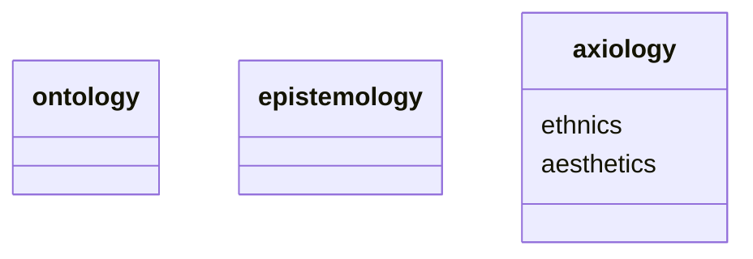

## 问题树

### 核心问题

#### OpenAI
* 本体论    -    存在的本质
* 认识论     -    认识的本质
* 心灵哲学    -    思维与现实的关系
* 价值论    -包含-    伦理学与美学    -    价值的本质
* 自由意志与因果性    -    自由与决定论
* 语言哲学    -    语言与意义
* 真理论    -    真理的本质
* 政治哲学    -    政治与社会的正义

#### 我的总结
* 形而上学 
    * 本体论
* 认识论
* 价值论
    * 伦理学
    * 美学
* 交叉领域
* 心灵哲学 形而上学+认识论
* 语言哲学 逻辑学+认识论
* 政治哲学  伦理学+形而上学

#### Deepseeek
* 本体论                 ——
    * 形而上学                |
* 认识论                 ————  心灵哲学
    * 逻辑学
    * 语言哲学
    * 科学哲学
* 价值论  
    * 伦理学  
        * 政治哲学
    * 美学
    

## 语言问题
* 以中文为主语言，从 中文 wiki 爬取主要结构，作为实体的主要名称 
* 后续的补充，从 斯坦福或其它权威网站上获取的补充属性，保留英文

## 导向
* 哲学分支（包括 交叉学科分支）为导向，延伸出各种概念、分支内理论, 学说或立场、哲学家和关系   
* 哲学历史   时间导向
* 哲学流派  

> 从中选出所有代表人物

> 选择一个主要分支，然后从这些导向上 丰富它

> 从哲学分支上生成问题，以哲学分支为实体，问题作为实体连接分支和问题

## schema 图数据模型

###  关系
* 分支与流派  
* 分支与理论

### 实体对齐
* Wikidata  保证每个实体的唯一性  参考 gpt-5回答

## 草稿
若是采用方案C 爬虫 + GPT API 的方法，爬取的数据中，存在 名称(人名、著作名、学派名、分支名等等)不统一的情况、语言不统一的情况，导致数据混乱，关系连接有问题，这种情况下有什么解决方案吗？

需求：本科计算机专业毕业课设，课题是：搭建一个基于知识图谱的学习路径规划系统， 准备选择哲学领域进行研究

* 针对对象：非哲学专业，不考虑用户画像，偏向通用科普类的系统

数据来源：编写爬虫，爬取互联网(如  wiki,  Stanford Encyclopedia of Philosophy， Internet Encyclopedia of Philosophy 等)
爬虫的要求：
    * 确保实体的唯一性： 权威实体库数据源
        * Wikidata（最重要！）：每个实体都有全球唯一ID（Q number）
        * DBpedia：维基百科的结构化版本
        * PhilPeople：哲学家数据库
    * 数据清洗
    * 实体识别和标准化  (关系抽取和实体识别的过程中，可以接入第三方 GPT API 进行辅助)
    * 结构化 JSON
    * 实体对齐和分类
  

* 技术栈： python + vue + neo4j
* 基本的需求：知识图谱的可视化(可以搜索、筛选、根据节点展开等)， 对话系统(可以对话生成学习路径，并展示相应的图谱可视化，通过接入第三方gpt api的方式)  

* schema的设计，没有完善的思路，有一些想法
    * 导向
        * 哲学分支（包括 交叉学科分支）
        * 历史
        * 哲学流派
        * 问题树(连接各个哲学分支)  --- 基于哲学分支或其它易获取的实体，生成
    * 实体属性尽可能客观、有现成的数据结构可爬取
    * 关系尽可能完备、自洽 (确认好所需的关系后，通过大模型对爬取的数据进行抽取)
    * 确保关键名称、年份时间、关键属性等的统一
    

需求：本科计算机专业毕业课设，课题是：搭建一个基于知识图谱的学习路径规划系统， 选择哲学领域进行研究

* 当前目录下，仅做了简单的文档说明和大致规划
* 每次执行操作前和操作结束后，在docs/todos文件夹下，根据给出的要求，创建或调整修改Todo列表，跟踪项目的实施（若现有的todo列表与要求不符，则根据要求修改现有的todo列表），并在每次任务完成后，更新Todo列表，并将实施的细节、测试方法的摘要记录在同文件夹下的Checkout文件中
* 项目实施的时候，要始终保持目录结构的统一，杜绝出现文件摆放杂乱，文件组织混乱，重复实现已实现功能等情况的出现

由于这是一个比较大的工程，能否将实施过程分阶段，划分成相对独立的模块进行实施，针对不同模块专门实现后，统合成最终项目？将大方向的实施阶段放在 docs/phases 下面， 现阶段实施的目标放在 docs/tasks 下面，根据实施过程保持更新

后端环境需要保持统一, 避免实施过长，导致忘记重要的配置信息，所有环境相关的配置信息，在创建和修改时都要同步更新到 docs/config 目录下

请思考我是否存在有欠考虑的点，请积极指出我的错漏，提出有效建议

